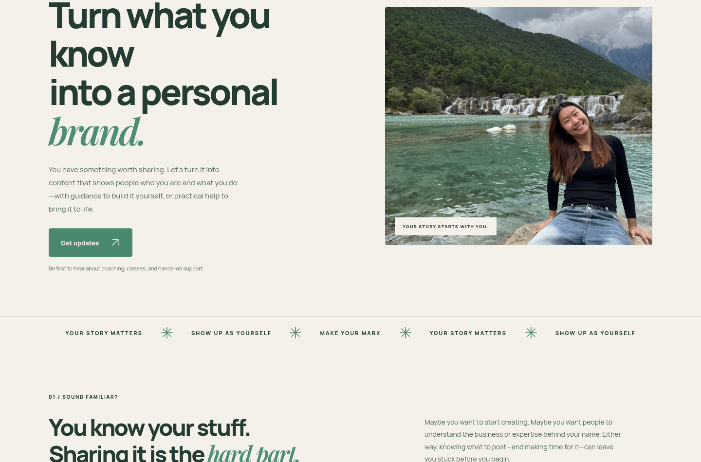

# Ray Chua — personal-branding landing page

A responsive landing page in Ray's muted green and beige, pairing bold Manrope headings with Playfair Display italic. The page follows one shared journey and introduces coaching/classes and hands-on support later in the page.

## See the design



## Open the full page on your computer

1. Open `landing-page-preview.html` in this repository.
2. Use GitHub's **Download raw file** button to download it.
3. Double-click the downloaded HTML file to open it in your browser.

The single HTML file includes the styles and fonts, so it needs no installation or server.

### Add your photos without uploading them to chat

At the top of `landing-page-preview.html`, choose an opening photo (the smiling waterfall portrait) and a Meet Ray photo (the gallery portrait). Adjust their vertical framing with the sliders, then click **Save my page with photos**. Open the downloaded `ray-landing-page-with-photos.html` to see the finished page without editor controls. Photos stay in your browser; there is no network upload, and the exported file embeds both images. HEIC photos should first be exported as JPG. This personalised file is local until you choose to host or share it.

The uploaded chat images were visible for selection advice but were not made available as source files in the coding workspace; the selectors let you use those originals directly. GitHub shows HTML source in its file viewer; downloading and opening the file displays the website.

## Develop

Run from this checkout:

```sh
python3 -m http.server 3000 --bind 0.0.0.0
```

Edit `index.html`, `styles.css`, and `fonts.css`. Fonts and their licences are under `fonts/`. Regenerate the standalone preview with `python3 scripts/build-preview.py` after updating the source. Serve the source files to deploy to a static web host.

## Current state

- Layout, shared signup navigation and FAQs checked at 1440, 768, 390 and 320 pixels.
- The name/email signup is explicitly marked as opening soon and disabled until a real email provider is connected. No email addresses are collected.
- Free training is not promised. The older hook-bank files are draft resources and are not linked from the landing page.
- This branch contains a draft website, not a public website deployment.
